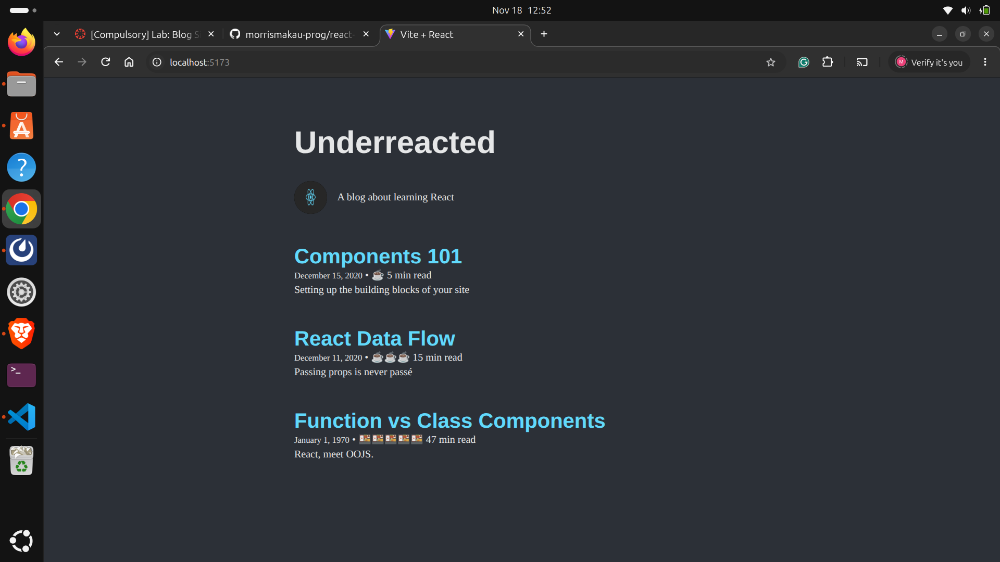

# Underreacted: Personal Blog (React + Vite)

A static personal blog site built with React to practice creating components,
writing JSX, and passing data down as props.

## Screenshot



## Getting Started

**Prerequisites:** [Node.js](https://nodejs.org/) (v18 or newer) and npm.

1. Install dependencies:
   ```bash
   npm install
   ```
2. Start the development server:
   ```bash
   npm run dev
   ```
3. Open the URL shown in the terminal (usually http://localhost:5173).

To run the tests:

```bash
npm test
```

## Component Tree

```
App
├── Header
├── About
└── ArticleList
    └── Article (one per blog post)
```

## Components

| Component | Description | Props | Parent | Children |
|-----------|-------------|-------|--------|----------|
| **App** | Root component. Imports `blog.js` and passes data down to its children. | none | `main.jsx` | Header, About, ArticleList |
| **Header** | Displays the blog name in an `<h1>` inside a `<header>`. | `name` | App | none |
| **About** | Displays the blog logo and description in an `<aside>`. Uses a placeholder image if none is passed. | `about`, `image` (optional) | App | none |
| **ArticleList** | Maps the `posts` array into `Article` components, each with a unique `key`, inside a `<main>`. | `posts` | App | Article |
| **Article** | Displays one post: title, date (defaults to January 1, 1970) and preview. | `title`, `date`, `preview` | ArticleList | none |

## Data Flow

Blog data lives in `blog.js`. `App` imports it and passes it down as props:

- `name` goes to `Header`
- `about` (and `image`) go to `About`
- `posts` goes to `ArticleList`, which passes each post's details to an `Article`

## Built With

- React
- Vite